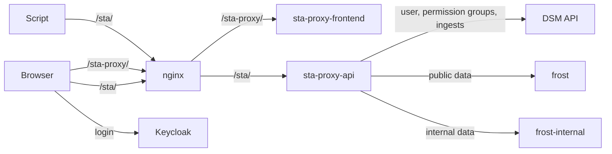
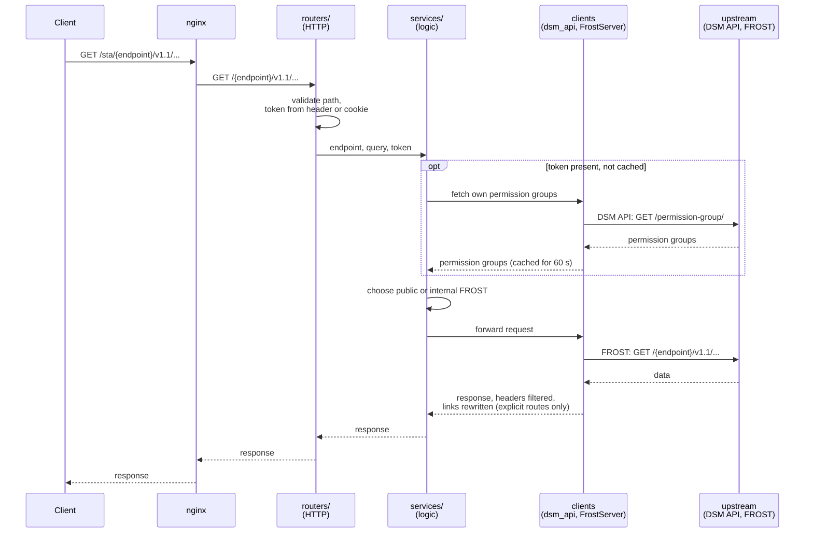
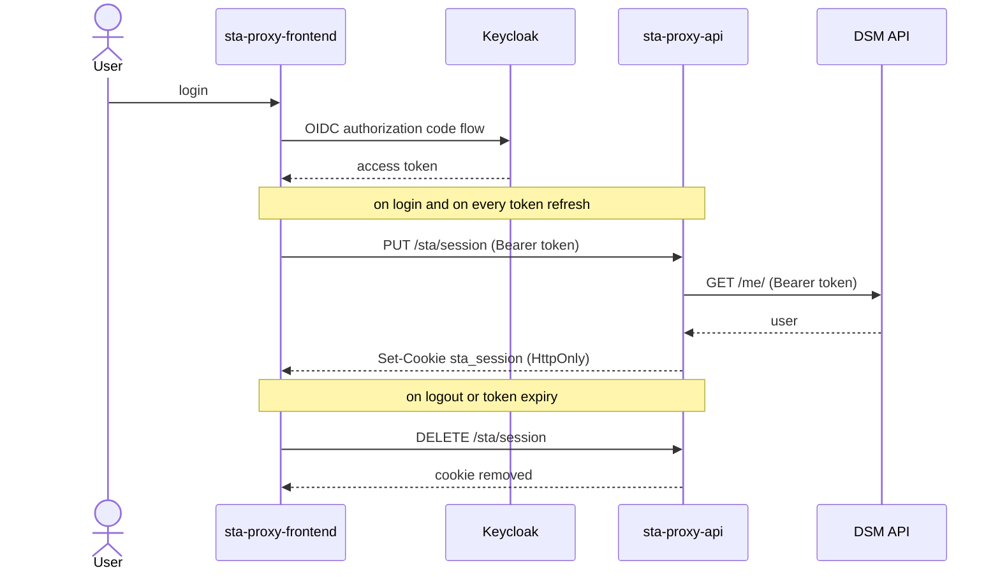
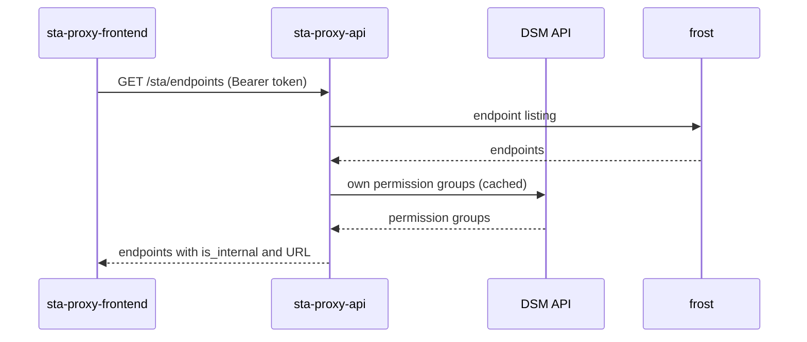
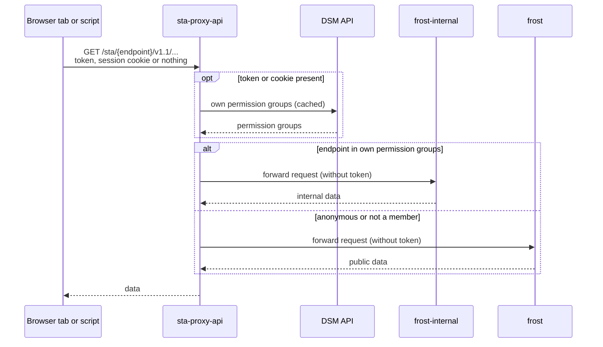
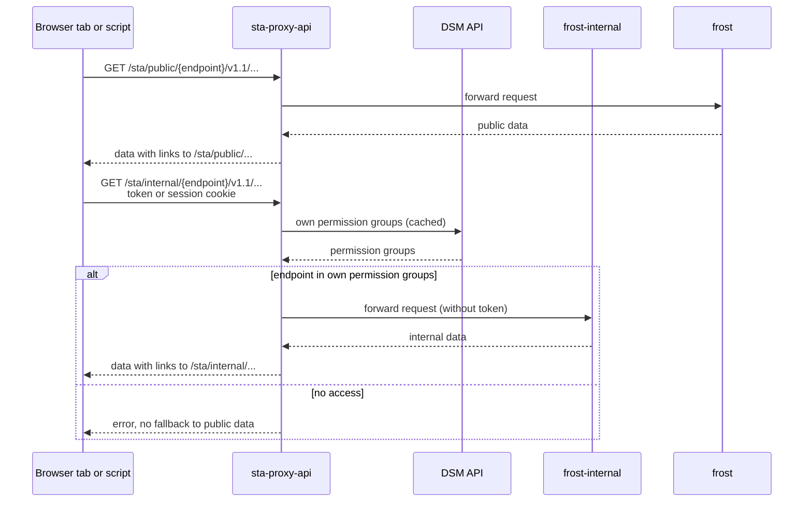

# STA Proxy Diagrams

Specific error responses and most [*unhappy paths*](https://en.wikipedia.org/wiki/Happy_path#Unhappy_path) are left out, see the [README](../README.md) for details.

## Components

The frontend runs in the browser, so its api calls and opened endpoint URLs pass nginx under `/sta/` as well.

## Layers of the api

A data request passing all layers. The other routes (`endpoints`, `ingests`, `me`, `session`) use the same layers.
See following diagrams for specific use cases.

## Login and session cookie

## Listing endpoints

## Requesting data

The default route chooses the FROST server by the token.

## Explicit routes

`/public` and `/internal` pin the FROST server. Links in the response are rewritten, so pagination stays on the route.

